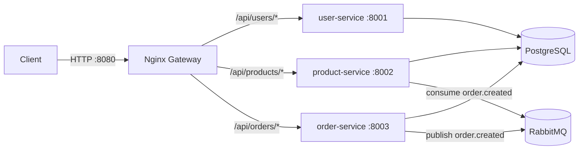

# ecommerce-microservices

A portfolio project demonstrating a production-style **FastAPI microservices** architecture with PostgreSQL, RabbitMQ, Nginx gateway, Docker Compose, and GitHub Actions CI.

---

## Architecture



---

## Tech Stack

| Layer | Technology |
|-------|-----------|
| Language | Python 3.12 |
| Framework | FastAPI |
| ORM | SQLAlchemy 2.x + asyncpg |
| Auth | JWT (python-jose) + bcrypt |
| Message Queue | RabbitMQ (aio-pika) |
| Gateway | Nginx (path-based routing) |
| Database | PostgreSQL 15 (one DB per service) |
| Containers | Docker + Docker Compose |
| CI | GitHub Actions |
| Tests | pytest + httpx TestClient |

---

## Services

| Service | Port | Responsibilities |
|---------|------|-----------------|
| user-service | 8001 | Register, login, `/me` – issues JWT tokens |
| product-service | 8002 | CRUD for products; consumes `order.created` to reduce stock |
| order-service | 8003 | Create & list orders; validates stock via REST; publishes `order.created` |
| gateway (Nginx) | 8080 | Routes `/api/users/*`, `/api/products/*`, `/api/orders/*` |

---

## Getting Started

```bash
# 1. Clone the repo
git clone https://github.com/<your-username>/ecommerce-microservices.git
cd ecommerce-microservices

# 2. Copy the example env file
cp .env.example .env

# 3. Start everything
docker compose up --build
```

All services will be reachable through the Nginx gateway at **http://localhost:8080**.

---

## Example curl flow

```bash
# Register a user
curl -X POST http://localhost:8080/api/users/register \
  -H "Content-Type: application/json" \
  -d '{"email":"alice@example.com","password":"secret123","full_name":"Alice"}'

# Login and capture token
TOKEN=$(curl -s -X POST http://localhost:8080/api/users/login \
  -d "username=alice@example.com&password=secret123" | python -c "import sys,json; print(json.load(sys.stdin)['access_token'])")

# Create a product (requires JWT)
curl -X POST http://localhost:8080/api/products/ \
  -H "Authorization: Bearer $TOKEN" \
  -H "Content-Type: application/json" \
  -d '{"name":"Laptop","description":"Fast laptop","price":999.99,"stock":10}'

# Create an order
curl -X POST http://localhost:8080/api/orders/ \
  -H "Authorization: Bearer $TOKEN" \
  -H "Content-Type: application/json" \
  -d '{"items":[{"product_id":1,"quantity":2}]}'

# List orders
curl http://localhost:8080/api/orders/ -H "Authorization: Bearer $TOKEN"
```

---

## Running Tests

```bash
# Install deps per service (or use a virtualenv)
cd user-service && pip install -r requirements.txt && pytest tests/ -v
cd product-service && pip install -r requirements.txt && pytest tests/ -v
cd order-service && pip install -r requirements.txt && pytest tests/ -v
```

Tests use in-memory stores and mock HTTP calls – no real database or RabbitMQ required.

---

## Design Decisions

| Decision | Why |
|----------|-----|
| **One DB per service** | Keeps service boundaries clear; a service can only access its own data, preventing tight coupling. |
| **Message queue (RabbitMQ)** | Decouples order-service from product-service. When an order is placed, product-service reduces stock asynchronously without a direct HTTP dependency. |
| **Nginx gateway** | Single entry point for clients; hides internal service topology; enables path-based routing without clients knowing individual service ports. |
| **JWT shared secret** | user-service issues tokens; product-service and order-service verify them without calling user-service on every request. |
| **In-memory stores** | Keeps the codebase simple and testable without needing a live database. Replace with SQLAlchemy + asyncpg for production. |

---

## Interview Questions

1. **Why use microservices instead of a monolith?** – Microservices allow independent deployment, scaling, and technology choices per service, though they add operational complexity. For a portfolio project they demonstrate familiarity with distributed systems.

2. **Why one database per service?** – Isolates data ownership, prevents one service from directly reading another's DB, and allows each service to evolve its schema independently.

3. **What is the role of RabbitMQ here?** – It decouples order creation from stock reduction. The order-service publishes an `order.created` event; the product-service consumes it and reduces stock asynchronously, so the two services don't need to be in sync at request time.

4. **How does JWT authentication work across services?** – user-service signs the token with a shared `JWT_SECRET`. Other services verify the signature with the same secret – no database call needed to authenticate a request.

5. **What is the Nginx gateway doing?** – It acts as a reverse proxy, routing `/api/users/*` to user-service, `/api/products/*` to product-service, and `/api/orders/*` to order-service. Clients talk to one port (8080) instead of three.

6. **How would you add persistence (a real database)?** – Replace the in-memory dicts with SQLAlchemy models and an `asyncpg` connection pool. The `database.py` file already sets up an async engine – just wire it into the routers with `get_db` dependency injection.

7. **How do you handle the order-service calling the product-service?** – Via HTTP using `httpx.AsyncClient`. The URL is set through an environment variable (`PRODUCT_SERVICE_URL`), so it can point to `localhost` in tests and to the Docker service name in production.

8. **What happens if RabbitMQ is down when an order is created?** – The publish is wrapped in a try/except; the HTTP response still succeeds. This is a best-effort pattern – for stronger guarantees you would use an outbox pattern or at-least-once delivery with acknowledgements.

9. **How are tests structured without a real database?** – The in-memory stores replace the database, and `unittest.mock.patch` / `AsyncMock` mock out HTTP calls to other services. This keeps tests fast and self-contained.

10. **How does the CI pipeline work?** – GitHub Actions runs a matrix job over the three services on every push: installs dependencies, runs pytest, then builds the Docker image. If any test fails, the Docker build step is skipped.
